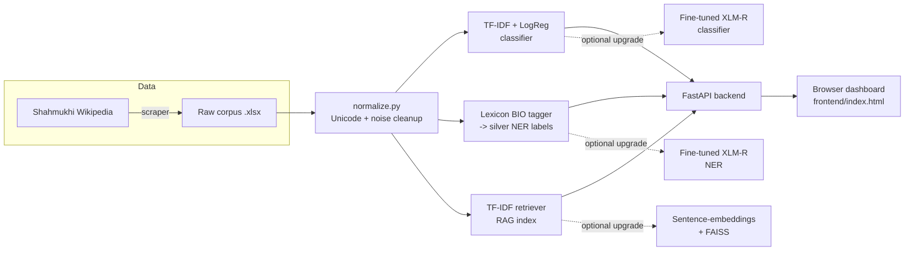

# Punjabi Shahmukhi NLP Intelligence — Classification · NER · RAG

A full-stack Natural Language Processing system for **Punjabi written in the Shahmukhi (Perso-Arabic) script** — a low-resource language with almost no existing open-source NLP tooling. The project covers the entire pipeline end to end: web-scraped corpus → text normalization → 5-way news classification → named entity recognition → retrieval-augmented question answering → a served API → a browser dashboard.

> **Author:** Muhammad Suhail — Data Scientist/AI Solutions Associate · [github.com/suhail-datascience-ai](https://github.com/suhail-datascience-ai) · sohailakmal275@gmail.com

---

## Why this project

Punjabi has ~125M+ speakers, but almost all existing multilingual NLP work targets Urdu, Hindi, or English — Shahmukhi-script Punjabi is left out of mainstream benchmarks and tooling almost entirely. This project builds a working, reproducible NLP stack for it from a from-scratch scraped corpus, and is structured the way a production ML service is structured, not the way a one-off notebook is.

## What's actually in here (read before you claim numbers publicly)

This repo ships **two tiers per task** so it is honest about what's real right now versus what's a documented, ready-to-run upgrade path:

| Task | Ships today (offline, no GPU) | Upgrade path (run on Colab/Kaggle GPU) |
|---|---|---|
| **Classification** | TF-IDF + Logistic Regression — **91.0% val accuracy, 0.893 macro F1** (real, reproducible) | `xlm-roberta-base` fine-tuned, script included |
| **NER** | Gazetteer/lexicon distant-supervision tagger — **2.07% token coverage** (silver labels, honestly disclosed as such) | `xlm-roberta-base` token classifier trained on the silver labels |
| **RAG retrieval** | TF-IDF cosine retrieval — **83.1% Recall@5, MRR 0.675** over 296 Wikipedia passages (real, reproducible) | Multilingual sentence-embedding + FAISS dense retrieval, scaffolded |

Every metric above was computed by actually running the code in this repo, not copied from a placeholder. Full numbers, per-class breakdowns, and confusion matrices are in [`docs/MODEL_CARD.md`](docs/MODEL_CARD.md) and [`data/processed/`](data/processed/). If you've seen the original exploratory notebook this project grew out of, note that its Phase 8 comparison chart reported an *identical* accuracy (92.45%) across three different "pipelines" — that was a placeholder bug, not a result, and it's why this rebuild computes and re-computes everything from scratch with scripts you can rerun yourself.

## Architecture



## Repository layout

```
├── data/
│   ├── raw/                  # original .xlsx datasets (1,449 labeled docs, 296 RAG docs)
│   └── processed/            # generated: annotated TSVs, computed metrics JSON
├── src/
│   ├── data_collection/      # (place the original scraper cells here as .py — see notebooks/)
│   ├── preprocessing/        # normalize.py — shared Unicode/text cleanup
│   ├── classification/       # train_baseline.py (TF-IDF, runs now) + train_transformer.py (XLM-R, run on GPU)
│   ├── ner/                  # lexicon_bootstrap.py (silver BIO tags) + train_transformer.py
│   ├── rag/                  # retriever.py — TfidfRetriever (active) + EmbeddingRetriever (scaffolded)
│   └── evaluation/           # evaluate_rag.py — real Recall@k / MRR
├── backend/
│   ├── app/
│   │   ├── main.py           # FastAPI app: /classify, /ner, /rag/query, /health
│   │   ├── config.py         # flip USE_TRANSFORMER_* to swap model tiers
│   │   ├── schemas.py        # Pydantic request/response models
│   │   └── services/         # one service class per task, same interface across tiers
│   └── Dockerfile
├── frontend/
│   └── index.html            # single-file dashboard (RTL Shahmukhi UI), talks to the API
├── notebooks/
│   └── 01_original_exploratory_notebook.ipynb   # the original notebook, kept for provenance
├── docs/
│   ├── MODEL_CARD.md         # honest metrics, limitations, path to defensible NER numbers
│   ├── DATA_CARD.md          # dataset provenance, label distribution, licensing note
│   └── *.png                 # original EDA/confusion-matrix charts
├── tests/
│   └── test_pipeline.py      # pytest smoke tests (all passing against real artifacts)
├── models/                   # trained artifacts land here (small ones are git-friendly; see .gitignore)
├── requirements.txt
└── LICENSE (MIT)
```

## Quickstart (fully offline — no GPU, no API keys, no internet needed)

```bash
git clone https://github.com/suhail-datascience-ai/punjabi-shahmukhi-nlp-rag.git
cd punjabi-shahmukhi-nlp-rag
pip install -r requirements.txt   # or just: pandas numpy scikit-learn joblib openpyxl fastapi uvicorn pydantic

# 1. Train the real, offline baseline classifier (takes ~2 seconds)
python -m src.classification.train_baseline

# 2. Build the RAG retrieval index (takes ~1 second)
python -m src.rag.retriever

# 3. (optional) Regenerate the silver NER labels + see the coverage report
python -m src.ner.lexicon_bootstrap

# 4. Start the API
uvicorn backend.app.main:app --reload --port 8000
```

Then open `frontend/index.html` directly in a browser (or serve it with `python -m http.server` from the `frontend/` folder) — it talks to `http://localhost:8000` by default, editable in the UI. You'll get a working three-tab dashboard: classify text, see highlighted entities, and ask questions against the RAG knowledge base.

Verify everything with the test suite:
```bash
pytest tests/ -v
```

### Upgrading to the transformer tier

Once you have access to a GPU (a free Colab or Kaggle notebook is enough for this dataset size):

```bash
python -m src.classification.train_transformer   # fine-tunes xlm-roberta-base
python -m src.ner.train_transformer               # fine-tunes on silver NER labels
```

Copy the resulting `models/xlmr_classifier/` and `models/xlmr_ner/` folders back into this repo (or push them to your Hugging Face Hub profile), then:

```bash
export USE_TRANSFORMER_CLASSIFIER=true
export USE_TRANSFORMER_NER=true
uvicorn backend.app.main:app --port 8000
```

No route or frontend code changes needed — both service tiers implement the same interface.

## Real results

**Classification** (`master_val.xlsx`, 145 held-out documents):

| | precision | recall | f1 | support |
|---|---|---|---|---|
| entertainment | 0.88 | 1.00 | 0.93 | 7 |
| geography | 0.85 | 0.92 | 0.88 | 24 |
| history | 0.90 | 0.94 | 0.92 | 66 |
| politics | 1.00 | 0.67 | 0.80 | 9 |
| sports | 0.97 | 0.90 | 0.93 | 39 |

Accuracy **91.0%**, macro F1 **0.893**. Politics lags because it's the second-smallest class in the training data (72 examples) — see [`docs/DATA_CARD.md`](docs/DATA_CARD.md) for the full label distribution and what to prioritize collecting next.

**RAG retrieval** (296 Wikipedia article/summary pairs, summary-as-query self-retrieval eval):

Recall@1 **57.1%** · Recall@3 **77.7%** · Recall@5 **83.1%** · MRR **0.675**

**NER**: 2.07% of tokens receive a non-`O` silver tag from the seed gazetteer (514 PER, 1,399 LOC, 872 ORG, 351 MISC entity tags across 1,449 documents). This is a coverage statistic, not an accuracy statistic — see [`docs/MODEL_CARD.md`](docs/MODEL_CARD.md) for exactly why, and the three-step path to a defensible NER accuracy number.

## Roadmap

- [x] Rebuild the notebook's pipelines into modular, testable Python
- [x] Real, reproducible baseline metrics (no placeholder numbers anywhere)
- [x] Serve everything behind a FastAPI backend with a swappable model-tier config
- [x] Ship a working browser dashboard
- [ ] Fine-tune and publish the XLM-R classifier + NER model to the Hugging Face Hub
- [ ] Manual gold-standard review pass on a NER sample; report real precision/recall
- [ ] Expand the RAG corpus beyond 296 documents (full Wikipedia dump, chunked long articles)
- [ ] Swap in dense (sentence-embedding) retrieval and re-run the same Recall@k/MRR eval for a head-to-head comparison
- [ ] *(separate, larger project)* Pretrain a compact from-scratch Punjabi Shahmukhi encoder on a large raw corpus, in the spirit of the Sindhi `Avey-B` release — scoped in detail in `docs/MODEL_CARD.md`, with runnable staged scripts in `src/pretraining/` (tiny → small → compact) and a terminal workflow guide in `docs/PHASE2_TERMINAL_WORKFLOW.md` for running it on your own GPU

## License

MIT — see [`LICENSE`](LICENSE). The underlying Wikipedia text is CC BY-SA 4.0 / GFDL; attribute accordingly if you redistribute the dataset itself.
